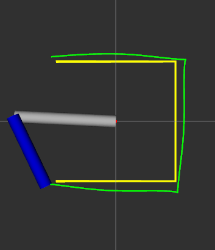

# scara_sim

## Overview
This project provides a comprehensive simulation of a 2-DOF planar SCARA robot using **ROS 2 Humble** and **Gazebo**. 

The core of the project is a custom Python implementation that handles:
- **Inverse Kinematics** (converting Cartesian X/Y coordinates to joint angles).
- **Trajectory Generation** (producing P-shaped and other Cartesian paths with specific velocity/acceleration profiles).
- **Lagrange Dynamics** (calculating the exact torques required for motion).
- **Effort Control** (publishing the calculated torques directly to the robot's joints).

The repository serves as a testbed for studying direct torque control, dynamic modeling, and trajectory tracking for robotic manipulators.

<div align="center">
  
</div>

## Dependencies
1. List of dependencies for ROS2 Humble:
- ros-humble-xacro
- ros-humble-ros-gz-sim
- ros-humble-ros-gz-bridge
- ros-humble-ros2-control
- ros-humble-ros2-controllers
- ros-humble-ign-ros2-control

2. Install dependencies
```bash
sudo apt update
sudo apt install \
    ros-humble-xacro \
    ros-humble-ros-gz-sim \
    ros-humble-ros-gz-bridge \
    ros-humble-ros2-control \
    ros-humble-ros2-controllers \
    ros-humble-ign-ros2-control
```

## Install and Start

1. Download pkg
```bash
mkdir -p some_ws/src
cd some_ws/src
git clone https://github.com/pavelmino44/scara_sim.git
```

2. Build 
```bash
cd ..
colcon build --symlink-install && source install/local_setup.bash
```

3. Launch simulation
```bash
ros2 launch scara_sim scara_sim.launch.py 
```

4. Run effort commands. In the new terminal:
```bash
cd some_ws
source install/local_setup.bash
ros2 launch scara_sim effort_publisher.launch.py
```

---

## Лабораторная работа: управляемое движение (ПИД-регулятор + ДПТ)

`effort_publisher` подаёт на сочленения расчётные моменты обратной динамики **без обратной связи**
и **без модели привода** — Gazebo прикладывает момент к шарниру мгновенно и без потерь.

В работе добавлены:
1. **модель приводов** — двигатели постоянного тока с редукторами (нода `dc_motor_sim`);
2. **ПИД-регулятор положения** сочленений, который управляет двигателями по напряжению (нода `pid_controller`).

```
                 U, В                      τ, Н·м
pid_controller ───────▶ dc_motor_sim ───────────▶ Gazebo (effort_controller)
      ▲          /dc_motors/voltage      /effort_controller/commands   │
      │                    ▲                                           │
      └────────────────────┴──────────── /joint_states (q, q̇) ◀────────┘
```

### Модель ДПТ (`dc_motor_sim`)

Для каждого сочленения:

```
L·di/dt = U − R·i − kₑ·N·q̇           электрическая цепь якоря
τ_m     = k_t·i                      момент на валу
τ       = η·N·τ_m − N²·(J_r·q̈ + b_m·q̇)   момент на шарнире (после редуктора)
```

* напряжение ограничено ±U_max (насыщение усилителя); при отсутствии команд > 0.1 с U = 0;
* электрическое уравнение интегрируется точно (экспонента) — устойчиво при L/R = 0.5 мс и шаге 1 мс;
* приведённая инерция ротора N²·J_r учитывается через оценку ускорения q̈
  (фильтрованная производная скорости, 100 Гц), т.к. в модели Gazebo её нет
  (`include_rotor_inertia: false` — отключить);
* состояние публикуется в `/dc_motors/state`: `[U₁..Uₙ, i₁..iₙ, τ₁..τₙ]`.

Параметры — `config/dc_motors.yaml` (условный ДПТ 24 В, R = 2 Ом, L = 1 мГн, k_t = kₑ = 0.05,
J_r = 5·10⁻⁶ кг·м², редукторы N = 50 / 30, η = 0.9). При запуске нода печатает пусковой момент
и скорость холостого хода на шарнире: 27 / 16.2 Н·м и 9.6 / 16 рад/с.

### Регулятор (`pid_controller`)

```
U = U_ff(t) + Kp·e + Ki·∫e dt + Kd·ė        [В]
e = wrap(q_des − q),   ė = q̇_des − q̇
```

Прямая связь по напряжению — обратная модель ДПТ:

```
i_ff = (τ_ff + N²·(J_r·q̈_des + b_m·q̇_des)) / (η·N·k_t)
U_ff = R·i_ff + L·di_ff/dt + kₑ·N·q̇_des
```

где `τ_ff, q_des, q̇_des, q̈_des` — из `trajectory.csv` (`trajectory_generator`).

* дифференциальная составляющая — по измеренной скорости (без численного дифференцирования ошибки);
* ошибка по углу приводится к [−π, π] (в Gazebo q1 стартует с 3.117 рад, в траектории это −3.166 рад);
* anti-windup: ограничение интеграла + остановка интегрирования при насыщении напряжения.

Режимы (`mode`): `ff` — только прямая связь, `pid` — только ПИД, `ff+pid` — оба (по умолчанию).
Исполнительное устройство (`actuator`): `motor` — через ДПТ (по умолчанию),
`torque` — момент прямо в Gazebo (идеальный привод, для сравнения; коэффициенты в `config/pid_gains_torque.yaml`).

### Запуск

```bash
# терминал 1 — симуляция (как раньше)
ros2 launch scara_sim scara_sim.launch.py

# терминал 2 — регулятор + модель ДПТ (вместо effort_publisher)
ros2 launch scara_sim pid_controller.launch.py                    # ДПТ, ff+pid
ros2 launch scara_sim pid_controller.launch.py mode:=pid
ros2 launch scara_sim pid_controller.launch.py mode:=ff
ros2 launch scara_sim pid_controller.launch.py actuator:=torque   # без двигателей
```

Регулятор 1 с удерживает начальную точку, отрабатывает траекторию, затем удерживает конечную точку,
печатает метрики (RMS/max ошибки, max напряжение и ток) и сохраняет лог
`install/scara_sim/share/scara_sim/data/pid_log_<actuator>_<mode>_<время>.csv`.

Перед повторным прогоном перезапустите симуляцию (робот должен стоять в начальной точке).
Не запускайте одновременно `effort_publisher` — он пишет в тот же топик моментов.

### Графики

```bash
ros2 run scara_sim plot_tracking --latest                           # последний лог
ros2 run scara_sim plot_tracking log_ff.csv log_pid.csv log_ff_pid.csv   # сравнение режимов
ros2 run scara_sim plot_tracking log_ff_pid.csv --save plots/       # PNG для отчёта
```

Строятся: траектория XY, ошибка схвата, ошибки по сочленениям, а для каждого лога —
U_ff / U_pid / U, ток якоря и момент на шарнире.

### Коэффициенты

`config/pid_gains.yaml`: `Kp = [300, 100] В/рад`, `Ki = [300, 100] В/(рад·с)`, `Kd = [8, 3] В·с/рад`.

Подбор без Gazebo — офлайн-модель той же динамики робота (совпадает с моделью Лагранжа из
`trajectory_generator` до 1e-12 Н·м), тех же классов ДПТ и регулятора:

```bash
ros2 run scara_sim offline_pid_sim --robot 2dof --actuator motor \
    --traj install/scara_sim/share/scara_sim/data/trajectory.csv \
    --motors install/scara_sim/share/scara_sim/config/dc_motors.yaml \
    --mode ff+pid --kp 300 100 --ki 300 100 --kd 8 3 --delay 1 --plot
```

`--delay N` — задержка измерения в мс (проверка запаса устойчивости), `--actuator torque` — без ДПТ.

Результаты на офлайн-модели (П-образная траектория, 30 с, обе ноды в замкнутом контуре):

| Привод | Режим   | RMS ошибки схвата | max ошибки | max \|U\| | max \|i\| |
|--------|---------|------------------:|-----------:|-----------:|-----------:|
| ДПТ    | ff      | ≈ 13.5 мм         | ≈ 19 мм    | 0.5 В      | 0.19 А     |
| ДПТ    | pid     | ≈ 0.26 мм         | ≈ 1.7 мм   | 1.3 В      | 0.59 А     |
| ДПТ    | ff+pid  | ≈ 0.10 мм         | ≈ 1.2 мм   | 1.5 В      | 0.70 А     |
| момент | ff      | ≈ 260 мм          | ≈ 450 мм   | —          | —          |
| момент | ff+pid  | ≈ 0.14 мм         | ≈ 1.5 мм   | —          | —          |

Наблюдения:
* противо-ЭДС делает двигатель с редуктором «демпфером» (приведённое электрическое демпфирование
  η·N²·k_t·kₑ/R ≈ 2.8 Н·м·с/рад для joint1), поэтому даже разомкнутое управление по напряжению
  уходит всего на ~1 см, а не на десятки сантиметров, как при идеальном источнике момента;
* основная часть U_ff — компенсация противо-ЭДС kₑ·N·q̇_des, поэтому прямая связь улучшает
  ПИД примерно в 2.5 раза;
* пики ошибки — на старте и в углах «П», где заданная скорость меняется скачком.
